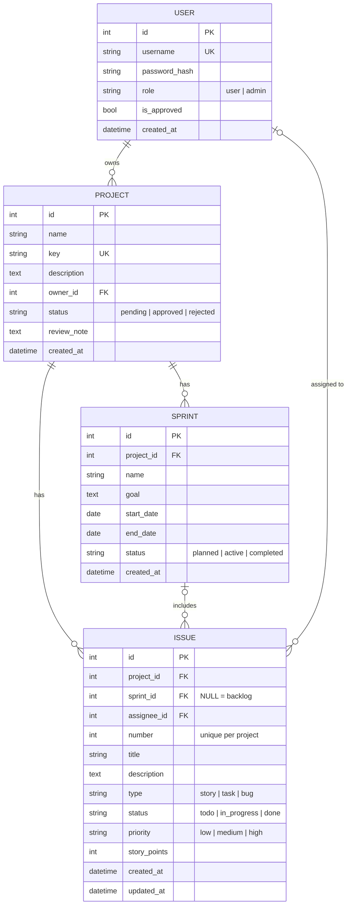

# SprintBoard

SprintBoard is a lightweight agile project board for small teams. It lets a team keep a product backlog, plan work into sprints and track progress on a To Do / In Progress / Done board, without the cost and complexity of tools such as Jira.

- **Live demo:** **TODO: add the Render URL after deploying** (the first load can take up to a minute while the free server wakes up)
- **API documentation:** `/docs` on any running instance (generated automatically by FastAPI)

---

## Contents

1. [Problem statement](#problem-statement)
2. [Features](#features)
3. [User roles](#user-roles)
4. [User guide](#user-guide)
5. [Tech stack](#tech-stack)
6. [Getting started](#getting-started)
7. [Running with Docker](#running-with-docker)
8. [Running the tests](#running-the-tests)
9. [Project structure](#project-structure)
10. [Architecture](#architecture)
11. [Data model](#data-model)
12. [Validation rules](#validation-rules)
13. [Error handling and logging](#error-handling-and-logging)
14. [API reference](#api-reference)
15. [Configuration](#configuration)
16. [Deployment (Render)](#deployment-render)
17. [Continuous integration](#continuous-integration)
18. [Scope and known limitations](#scope-and-known-limitations)

---

## Problem statement

Small teams often track their work in spreadsheets, emails or sticky notes. That makes it hard to see what is in progress, who owns each task and whether a sprint is on track. Commercial tools solve this but are expensive and complex for a team of a few people.

SprintBoard gives a small team the core agile workflow in one simple web app:

**Backlog** → **plan a sprint** → **work on the board** → **complete the sprint**. Unfinished work goes back to the backlog automatically.

---

## Features

### Accounts and access
- Register and log in with a username and password. Passwords are hashed with bcrypt and sessions use JWT access tokens.
- The **first account registered becomes the admin**. Every later account must be **approved by an admin** before it can log in.
- Users only see their own projects. Admins can see and manage everything.

### Projects
- Users **request** a new project, and an admin **approves** or **rejects** it (optionally giving a reason).
- A rejected request can be edited and resubmitted.
- Each project has a short unique **key** (e.g. `SB`), which is used in issue ids such as `SB-12`.
- Projects can be edited or deleted. Deleting a project also deletes its issues and sprints.

### Backlog and issues
- Create, edit and delete issues (stories, tasks and bugs) with a priority, story points and an assignee.
- The backlog page shows every planned or active sprint plus the backlog itself.
- **Drag and drop** issues between the backlog and any planned or active sprint, or use the Sprint dropdown on each row.

### Sprints
- Create sprints with a name, goal, start date and end date.
- **Start** a sprint. Only one sprint per project can be active at a time.
- **Complete** a sprint. Any issue that is not Done is moved back to the backlog automatically.
- The sprints page shows each sprint's progress (issues done out of the total).

### Board
- The active sprint is shown as three columns: **To Do**, **In Progress** and **Done**.
- **Drag cards between columns** with a mouse, by touch (press and hold) or with the keyboard (Space to pick up, arrow keys to move, Space to drop). Each card also has ← / → buttons.
- Changes appear instantly and are then saved. If saving fails, the card moves back and an error message is shown.

### Usability
- Forms show validation errors next to each field as you type, and the server checks the same rules again.
- Every action shows a clear success or error notification.
- The layout is responsive, and supports light and dark mode (it follows your system setting).

---

## User roles

| | User | Admin |
|---|---|---|
| Register an account | ✅ (waits for approval) | ✅ (first account only) |
| Create projects | Sends a **request** | Approved straight away |
| See and edit own projects, issues and sprints | ✅ | ✅ |
| See and edit other people's projects | ❌ | ✅ |
| Approve or reject new accounts | ❌ | ✅ (**Users** page) |
| Approve or reject project requests | ❌ | ✅ (**Requests** page) |
| Promote or demote users, delete accounts | ❌ | ✅ (not their own account) |

The header shows admins a yellow count of accounts and project requests that are waiting for them.

---

## User guide

This section explains how to use SprintBoard in the browser. The setup instructions for running it yourself are in [Getting started](#getting-started).

### 1. Create an account and log in

1. Open the app and click **Register** under the login form.
2. Choose a **username** (3–30 letters, numbers or underscores) and a **password** (at least 8 characters), then type the password again to confirm it.
3. Click **Create account**.
   - If you are the **first person** to register, or you use the admin login you were given, you are logged in straight away as the **admin**.
   - Otherwise you will see *"Account created. You can log in once an admin approves it."* Ask an admin to approve you, then log in.
4. On the **Log in** page, enter your username and password. If you see *"Your account is waiting for an admin to approve it"*, your account hasn't been approved yet.

You stay logged in when you refresh the page. Use **Log out** in the top-right corner when you're finished.

### 2. Request a project

1. On the **Projects** page, click **Request project**. (Admins see **New project** instead, and their projects are approved straight away.)
2. Fill in:
   - **Name:** for example *Company website*.
   - **Key:** 2–5 letters, such as `WEB`. It appears in every issue id (`WEB-1`, `WEB-2`, and so on) and can't be changed later.
   - **Description:** optional.
3. Click **Send request**. The project card shows **Awaiting approval** until an admin reviews it.
4. When it's approved, the card shows an **Open** button.
   - If it's **Rejected**, the card shows the admin's reason. Click **Edit & resubmit**, make your changes and save, and it goes back to the admin.

Use **Edit** or **Delete** on a project card to change or remove a project. Deleting a project also deletes all its issues and sprints, and you'll be asked to confirm first.

### 3. Build the backlog

Open a project and go to the **Backlog** tab.

1. Click **Create issue** and fill in:
   - **Title** (required): what needs to be done.
   - **Description:** optional details.
   - **Type:** *Story*, *Task* or *Bug*.
   - **Priority:** *Low*, *Medium* or *High*.
   - **Story points:** 1, 2, 3, 5, 8 or 13. Leave it empty if the issue isn't estimated yet.
   - **Assignee:** who will work on it. Leave it as *Unassigned* if no one is yet.
   - **Sprint:** leave it as *Backlog (no sprint)* for now.
2. Click an issue's **title** to edit it, or click **Delete** on its row to remove it.

### 4. Plan a sprint

1. Go to the **Sprints** tab and click **New sprint**.
2. Give it a **name**, an optional **sprint goal**, and a **start date** and **end date**. The end date must be after the start.
3. Click **Add issues** next to the planned sprint, or go back to the **Backlog** tab.
4. Move issues into the sprint in either of these ways:
   - **Drag** an issue row (use the ⠿ handle on the left) onto the sprint's section.
   - Use the **Sprint** dropdown on the issue's row.

   You can move issues back to the backlog the same way. Sprints that haven't started can be filled in advance.
5. When you're ready, go to **Sprints** and click **Start sprint**. Only one sprint per project can be active at a time.

### 5. Work on the board

Go to the **Board** tab to see the active sprint's issues in three columns: **To Do**, **In Progress** and **Done**.

There are three ways to move an issue to a new status:
- **Mouse:** drag the card to another column.
- **Touch screen:** press and hold the card, then drag it.
- **Keyboard:** press Tab to reach a card, Space to pick it up, the arrow keys to move it, and Space to drop it.

Each card also has **← / →** buttons. Click a card's title to edit the issue.

### 6. Complete the sprint

1. On the **Sprints** tab, check each sprint's progress bar (issues done out of the total).
2. Click **Complete** on the active sprint. The confirmation message tells you how many unfinished issues will go back to the backlog.
3. Click **Complete sprint**. Done issues stay in the completed sprint, and everything else returns to the backlog, ready for the next sprint.

### 7. Admin tasks

Admins see two extra links in the header. A yellow number shows how many items are waiting.

- **Users:**
  - New accounts are listed first with an **Awaiting approval** badge. Click **Approve** to let someone log in, or **Reject** to remove the sign-up.
  - Change anyone's **Role** between *User* and *Admin*, or **Delete** an account. Deleting an account also removes that user's projects.
  - You can't change your own role or delete yourself.
- **Requests:**
  - Each pending project request shows who asked and when.
  - Click **Approve** to accept it, or **Reject** and optionally give a reason that the user will see.

Admins can also open, edit and delete **every** project from the **Projects** page, which is titled *All projects* for them.

### Messages you might see

| Message | What it means |
|---|---|
| *Your account is waiting for an admin to approve it* | Your account exists, but an admin hasn't approved it yet |
| *Incorrect username or password* | Check your details and try again |
| *This project has not been approved by an admin yet* | You can't add issues or sprints until the project request is approved |
| *'Sprint X' is already active. Complete it first.* | Only one sprint per project can be active at a time |
| *Issues cannot be added to a completed sprint* | Pick a planned or active sprint instead |
| *Your session has expired. Please log in again* | Your login has timed out (after 8 hours), so log in again |
| *Cannot reach the server* | The server is offline or still waking up. Wait a moment and try again |

---

## Tech stack

| Layer | Technology |
|---|---|
| Backend | Python 3.13, **FastAPI**, SQLAlchemy 2, Pydantic 2, pydantic-settings |
| Database | **SQLite** (a single file: `backend/sprintboard.db`) |
| Authentication | bcrypt password hashing, JWT tokens (PyJWT) |
| Frontend | **React 19 + TypeScript**, Vite, **Mantine** UI components, React Router, dnd-kit (drag and drop) |
| Testing | pytest with FastAPI's `TestClient` |
| Tooling | **uv** (Python packages), npm, oxlint, GitHub Actions, **Docker** / Docker Compose |
| Hosting | **Render** (free web service) |

In production, FastAPI serves both the API (under `/api`) and the built React app, so the whole system runs as **one service on one URL**.

---

## Getting started

### Prerequisites

- **Python 3.13** and **[uv](https://docs.astral.sh/uv/)** (`brew install uv` or `pip install uv`)
- **Node.js 22** and npm

### 1. Install everything

From the project root:

```bash
npm run setup
```

This installs the root tools, the frontend packages (`frontend/node_modules`) and the Python packages (`backend/.venv`).

### 2. Start the app

```bash
npm run dev
```

This starts both servers together:

| Server | URL |
|---|---|
| Frontend (open this one) | http://localhost:5173 |
| Backend API | http://localhost:8000 |
| Interactive API docs | http://localhost:8000/docs |

During development, Vite forwards any request starting with `/api` to the backend, so there is no CORS setup. Press **Ctrl+C** to stop both servers.

### 3. Create the admin account

There are two ways to do this:

- **Register it:** open http://localhost:5173/register and create an account. **The first account becomes the admin** and is logged in straight away.
- **Set it in `.env`:** copy `backend/.env.example` to `backend/.env` and set `ADMIN_USERNAME` and `ADMIN_PASSWORD`. That admin is created when the app starts (see [Configuration](#configuration)).

### 4. (Optional) Add demo data

```bash
npm run seed
```

This adds a demo project, **SprintBoard Development (`SB`)**, owned by the admin. It includes a completed sprint, an active sprint and a backlog of issues. The script creates no accounts and contains no passwords. It does nothing if the demo project already exists.

### 5. Try the user flow

1. Log out and register a second account. It shows *"You can log in once an admin approves it"*.
2. Log back in as the admin, open **Users** and click **Approve**.
3. Log in as the new user and click **Request project**.
4. As the admin, open **Requests** and approve the request.

### Other commands

| Command | What it does |
|---|---|
| `npm run dev` | Start the backend and frontend together |
| `npm run dev:backend` / `npm run dev:frontend` | Start just one of them |
| `npm test` | Run the backend test suite |
| `npm run seed` | Add the demo project for the admin |
| `npm run build` | Build the frontend into `frontend/dist` |
| `npm --prefix frontend run lint` | Lint the frontend with oxlint |

### Running the production build locally

```bash
npm run build
cd backend && uv run uvicorn app.main:app --port 8000
```

Then open http://localhost:8000. FastAPI serves the built React app and sends any non-API path (such as `/projects/1/board`) to `index.html`, so page refreshes work.

### Starting again with an empty database

Stop the app, delete `backend/sprintboard.db`, then start it again. A new empty database is created on startup.

---

## Running with Docker

You can also run the whole app (frontend and backend) in a single container. You only need [Docker](https://docs.docker.com/get-docker/); you don't need Python, uv or Node installed.

```bash
cp backend/.env.example backend/.env   # then set ADMIN_USERNAME, ADMIN_PASSWORD and SECRET_KEY
docker compose up --build
```

Open http://localhost:8000. If you set `ADMIN_USERNAME` and `ADMIN_PASSWORD`, log in with them. Otherwise, the first account you register becomes the admin.

| Command | What it does |
|---|---|
| `docker compose up --build -d` | Build the image and start the app in the background |
| `docker compose logs -f` | Follow the app's logs |
| `docker compose down` | Stop the app (your data is kept) |
| `docker compose down -v` | Stop the app **and delete the database volume** |
| `APP_PORT=9000 docker compose up` | Use a different port on your computer |
| `docker compose exec app python seed.py` | Add the demo project (needs an admin first) |

**How the image is built** (`Dockerfile`, two stages):
1. **Frontend stage** (`node:22-alpine`): runs `npm ci` and `npm run build` to produce `frontend/dist`.
2. **Runtime stage** (`python:3.13-slim`): installs the backend's production packages from `uv.lock` and copies in the built frontend. Uvicorn then serves the API and the website on port 8000.

**Other details**
- **Database:** stored at `/data/sprintboard.db` inside a named Docker volume (`sprintboard-data`), so it survives restarts and rebuilds.
- **Security:** the container runs as a non-root user.
- **Health check:** Docker calls `/api/health` every 30 seconds.
- **What's left out:** `.dockerignore` keeps `.env`, local databases, logs, tests and `node_modules` out of the image, so no secrets are built into it.
- **Port:** the container respects a `PORT` environment variable, so the same image works on hosts such as Render.

---

## Running the tests

```bash
npm test
# or, from backend/:
uv run pytest
```

The suite contains **79 tests** and runs in about a second. Each test uses a fresh in-memory SQLite database, so your real data is never touched.

| File | Covers |
|---|---|
| `test_auth.py` | Registration, login, validation, failed-login logging, tokens |
| `test_account_approval.py` | First user becomes admin, approval required before login |
| `test_admin.py` | Admin-only endpoints, roles, deleting users |
| `test_admin_bootstrap.py` | Admin account from `ADMIN_USERNAME` / `ADMIN_PASSWORD` |
| `test_projects.py` | Project CRUD, key rules, users only seeing their own projects |
| `test_project_requests.py` | Project request, approve and reject, resubmission |
| `test_issues.py` | Issue CRUD, numbering, field validation, sprint and assignee checks |
| `test_sprints.py` | Date rules, one active sprint, completing a sprint returns unfinished work |
| `test_health.py` | Health check |

---

## Project structure

```
SprintBoard/
├── backend/
│   ├── app/
│   │   ├── main.py              # Creates the app, registers routers and error handlers, serves frontend/dist
│   │   ├── config.py            # Settings from environment variables / .env
│   │   ├── database.py          # SQLAlchemy engine, session, get_db dependency
│   │   ├── logging_config.py    # Console + logs/app.log
│   │   ├── core/
│   │   │   ├── security.py      # bcrypt hashing, JWT create/verify
│   │   │   ├── dependencies.py  # Current user, admin-only, owned/approved project
│   │   │   ├── exceptions.py    # Domain errors (NotFound, Conflict, Forbidden, ...)
│   │   │   └── error_handlers.py# Global handlers: log + clear JSON message
│   │   ├── models/              # SQLAlchemy tables: user, project, sprint, issue, enums
│   │   ├── schemas/             # Pydantic request/response models and validation
│   │   ├── services/            # Business rules (auth, user, project, sprint, issue)
│   │   └── routers/             # Thin HTTP layer: auth, projects, issues, sprints, admin
│   ├── tests/                   # pytest suite (see above)
│   ├── seed.py                  # Optional demo data for the admin
│   ├── pyproject.toml / uv.lock # Python dependencies (managed with uv)
│   └── sprintboard.db           # SQLite database (created on first run)
│
├── frontend/
│   ├── src/
│   │   ├── main.tsx             # MantineProvider, notifications
│   │   ├── App.tsx              # Routes and route guards
│   │   ├── api/                 # fetch wrapper + one module per resource
│   │   ├── context/             # AuthContext (current user, login, logout)
│   │   ├── hooks/               # Project data loading, drag sensors, pending counts
│   │   ├── components/          # Layouts, forms, tables, board columns, cards
│   │   ├── pages/               # Login, Register, Projects, Backlog, Sprints, Board, Admin pages
│   │   ├── types/               # TypeScript types matching the Pydantic schemas
│   │   └── utils/               # Labels/colours, validation rules, notifications
│   └── vite.config.ts           # Dev proxy /api → http://localhost:8000
│
├── .github/workflows/ci.yml     # Tests + frontend build on every push
├── Dockerfile                   # Two-stage image: builds the frontend, runs the backend
├── docker-compose.yml           # Runs the image with a persistent database volume
├── .dockerignore                # Keeps secrets, local data and node_modules out of the image
├── render.yaml                  # Render deployment blueprint
└── package.json                 # Root scripts (setup, dev, test, seed, build)
```

---

## Architecture

The backend is split into layers, and each layer has one job:

```
HTTP request
   │
   ▼
routers/      Thin layer: reads the request and calls a service (no business logic)
   │
   ▼
schemas/      Pydantic validates and cleans every input before it reaches a service
   │
   ▼
services/     Business rules (e.g. "only one active sprint", "admins approve projects")
   │           raise domain errors such as NotFoundError or ConflictError
   ▼
models/       SQLAlchemy tables, stored in SQLite
```

Some key design decisions:

- **One access rule.** `can_manage(project, user)` in `project_service.py` decides access for projects, issues and sprints alike, so the rule lives in one place.
- **Domain errors are separate from HTTP.** Services raise errors like `ConflictError` without knowing about HTTP. `core/error_handlers.py` turns them into status codes and messages.
- **Dependencies do the shared checks.** FastAPI dependencies (`CurrentUser`, `AdminUser`, `OwnedProject`, `ApprovedProject`) handle authentication and access before a route runs.
- **Hidden means not found.** Other users' projects return *404 Not Found* rather than *403*, so users can't discover which projects exist.
- **The frontend is only the interface.** Every rule is enforced on the server. The React app repeats the validation only to give instant feedback.

---

## Data model



- An issue whose `sprint_id` is NULL is in the **backlog**.
- Issue keys such as `SB-12` combine the project key and the issue `number`.
- Deleting a project deletes its sprints and issues. Deleting a user deletes the projects they own, and any issues assigned to them become unassigned.

---

## Validation rules

Every rule is enforced by the backend (Pydantic schemas and services) and repeated in the React forms for instant feedback.

| Field / action | Rule |
|---|---|
| Username | 3–30 characters; letters, numbers and underscores only; unique; stored in lowercase |
| Password | At least 8 characters (at most 72 bytes, bcrypt's limit); stored hashed, never logged |
| Login | Account must be approved by an admin |
| Project name | 3–100 characters |
| Project key | 2–5 letters, unique, converted to uppercase; cannot be changed later |
| Project description | Up to 500 characters (optional) |
| Project usage | Issues and sprints can only be added once the project is approved |
| Reject reason | Up to 300 characters (optional) |
| Issue title | 3–120 characters |
| Issue description | Up to 2000 characters (optional) |
| Issue type / status / priority | Must be one of the fixed values listed in the data model |
| Story points | 1, 2, 3, 5, 8 or 13 (or none) |
| Issue sprint | Must belong to the same project and must not be completed |
| Sprint name / goal | 3–60 characters / up to 300 characters |
| Sprint dates | End date must be after the start date |
| Start sprint | Only a planned sprint, and only if no other sprint in the project is active |
| Complete sprint | Only the active sprint; unfinished issues return to the backlog |
| Admin actions | Admins cannot change their own role or delete their own account, so at least one admin always exists |

Validation errors are returned as one readable sentence, for example:

```json
{ "detail": "Title: String should have at least 3 characters" }
```

---

## Error handling and logging

- Logs go to the **console** and to **`backend/logs/app.log`** (which rotates at 1 MB and keeps 3 old files).
- Global exception handlers in `core/error_handlers.py` log every problem and return a clear JSON `detail` message:

| What happens | Status code | Logged as |
|---|---|---|
| Business rule broken (e.g. a second active sprint) | 400 / 409 | WARNING |
| Invalid input | 422 | WARNING, with the field and the reason |
| Not logged in / failed login | 401 | WARNING, with the username but never the password |
| Unapproved account tries to log in | 403 | WARNING |
| Non-admin uses an admin endpoint | 403 | WARNING |
| Unknown page or record | 404 | WARNING |
| Unexpected crash | 500 | ERROR, with the full traceback; the user sees a generic message |

Important actions are logged at INFO level, such as registrations, logins, approvals, role changes, project requests, and starting or completing sprints.

---

## API reference

Every endpoint except register, login and health requires an `Authorization: Bearer <token>` header. The full interactive documentation is at **`/docs`**.

### Auth and users
| Method | Path | Description |
|---|---|---|
| POST | `/api/auth/register` | Create an account (the first becomes admin; others wait for approval) |
| POST | `/api/auth/login` | Log in and receive a token |
| GET | `/api/auth/me` | The current user |
| GET | `/api/users` | Approved users (for the assignee list) |

### Projects
| Method | Path | Description |
|---|---|---|
| GET | `/api/projects` | Your projects (admins: all projects) |
| POST | `/api/projects` | Create a project (users: creates a request) |
| GET / PUT / DELETE | `/api/projects/{id}` | View, edit (resubmits a rejected request) or delete a project |

### Issues
| Method | Path | Description |
|---|---|---|
| GET / POST | `/api/projects/{id}/issues` | List or create issues (approved projects only) |
| GET / PUT / DELETE | `/api/issues/{id}` | View, update (incl. status and sprint) or delete an issue |

### Sprints
| Method | Path | Description |
|---|---|---|
| GET / POST | `/api/projects/{id}/sprints` | List or create sprints (approved projects only) |
| POST | `/api/sprints/{id}/start` | Start a planned sprint |
| POST | `/api/sprints/{id}/complete` | Complete the active sprint; returns how many issues went back to the backlog |

### Admin (admins only)
| Method | Path | Description |
|---|---|---|
| GET | `/api/admin/users` | All accounts, with approval status and project counts |
| POST | `/api/admin/users/{id}/approve` | Approve a new account |
| PUT | `/api/admin/users/{id}/role` | Change a user's role (`user` / `admin`) |
| DELETE | `/api/admin/users/{id}` | Delete an account, or reject a sign-up |
| GET | `/api/admin/project-requests` | Pending project requests |
| POST | `/api/admin/projects/{id}/approve` | Approve a project request |
| POST | `/api/admin/projects/{id}/reject` | Reject a project request, with an optional `reason` |

### Other
| Method | Path | Description |
|---|---|---|
| GET | `/api/health` | Returns `{"status": "ok"}` |

---

## Configuration

Settings are read from environment variables or from an optional `backend/.env` file. That file is git-ignored, so never commit it.

| Variable | Default | Purpose |
|---|---|---|
| `SECRET_KEY` | a development-only value | Signs login tokens. **Always set this in production.** |
| `DATABASE_URL` | `sqlite:///backend/sprintboard.db` | Database location |
| `ACCESS_TOKEN_EXPIRE_MINUTES` | `480` (8 hours) | How long a login lasts |
| `LOG_LEVEL` | `INFO` | Logging detail |
| `ADMIN_USERNAME` | not set | Optional admin account, created (or restored) **every time the app starts** |
| `ADMIN_PASSWORD` | not set | Password for that admin (at least 8 characters). Set it only in `backend/.env` or Render's dashboard |

`backend/.env.example` lists these variables. Copy it to `backend/.env` and fill in your own values.

When both admin variables are set, the app makes sure that account exists, is an approved admin and uses that password each time it starts. If the values break a validation rule (e.g. a short password), the app logs an error, skips that step and starts normally. The password itself is never logged.

---

## Deployment (Render)

The app is deployed as a single free **Render web service**, defined in `render.yaml`:

- **Build:** builds the React app, installs uv, then installs the Python packages from `uv.lock`
- **Start:** `uvicorn app.main:app` serves the API and the built frontend on one URL
- **Health check:** `/api/health`
- **Environment:** `PYTHON_VERSION=3.13.7`; `SECRET_KEY` is generated by Render; `ADMIN_USERNAME` and `ADMIN_PASSWORD` are entered by you

To deploy, push the repository to GitHub. In Render choose **New → Blueprint** and select the repository. Render then asks for `ADMIN_USERNAME` and `ADMIN_PASSWORD`. They are stored only in Render, never in the repository. You can change them later under **Environment** in the service's settings.

**Free-tier notes**
- The service **sleeps after 15 minutes** without visitors, and the next visit takes about a minute to wake it.
- Render's free tier has **no permanent disk**, so the SQLite database is **wiped every time the service sleeps, restarts or redeploys**.
- Because the admin account is rebuilt from `ADMIN_USERNAME` and `ADMIN_PASSWORD` on every start, **you can always log in as the admin**, even after a wipe. Other accounts and any data created on the hosted site are lost after 15 minutes without visitors.
- Since the admin always exists, new sign-ups on the hosted site always wait for approval. Nobody else can become admin by registering first.
- The free tier includes 750 running hours a month, enough to keep one service available all month.

---

## Continuous integration

`.github/workflows/ci.yml` runs on every push and pull request:

1. **Backend:** installs the Python packages with uv and runs `pytest`.
2. **Frontend:** runs `npm ci`, then `npm run build` (TypeScript type check + Vite build).

---

## Scope and known limitations

**Not included (out of scope for this version):**
- Comments on issues, file attachments
- Search, filters, reports and charts
- Email notifications, real-time updates between users
- Project members or sharing a project between several users (an admin can manage any project)
- Password reset

**Known limitations:**
- SQLite on Render's free tier is not persistent (see [Deployment](#deployment-render)).
- Login tokens are stored in the browser's `localStorage`. That's acceptable for a project of this scope, but an HTTP-only cookie would be safer in production.
- Issues are not ordered within a board column; they are listed by issue number.
