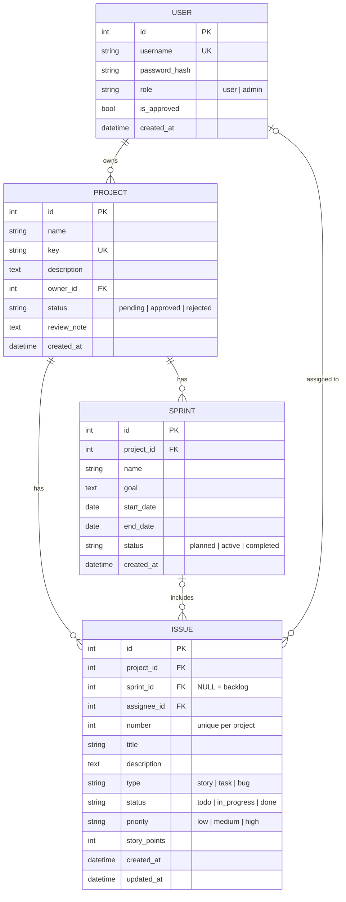

# SprintBoard

SprintBoard is a lightweight agile project board for small teams. It lets a team keep a product backlog, plan work into sprints and track progress on a To Do / In Progress / Done board, without the cost and complexity of tools such as Jira.

- **Live demo:** _add your Render URL here_ (the first load can take up to a minute while the free server wakes up)
- **API documentation:** `/docs` on any running instance (generated automatically by FastAPI)

---

## Contents

1. [Problem statement](#problem-statement)
2. [Features](#features)
3. [User roles](#user-roles)
4. [Tech stack](#tech-stack)
5. [Getting started](#getting-started)
6. [Running the tests](#running-the-tests)
7. [Project structure](#project-structure)
8. [Architecture](#architecture)
9. [Data model](#data-model)
10. [Validation rules](#validation-rules)
11. [Error handling and logging](#error-handling-and-logging)
12. [API reference](#api-reference)
13. [Configuration](#configuration)
14. [Deployment (Render)](#deployment-render)
15. [Continuous integration](#continuous-integration)
16. [Scope and known limitations](#scope-and-known-limitations)

---

## Problem statement

Small teams often track their work in spreadsheets, emails or sticky notes. That makes it hard to see what is in progress, who owns each task and whether a sprint is on track. Commercial tools solve this but are expensive and complex for a team of a few people.

SprintBoard gives a small team the core agile workflow in one simple web app:

**Backlog** → **plan a sprint** → **work on the board** → **complete the sprint**. Unfinished work goes back to the backlog automatically.

---

## Features

### Accounts and access
- Register and log in with a username and password. Passwords are hashed with bcrypt and sessions use JWT access tokens.
- The **first account registered becomes the admin**. Every later account must be **approved by an admin** before it can log in.
- Users only see their own projects. Admins can see and manage everything.

### Projects
- Users **request** a new project, and an admin **approves** or **rejects** it (optionally giving a reason).
- A rejected request can be edited and resubmitted.
- Each project has a short unique **key** (e.g. `SB`), which is used in issue ids such as `SB-12`.
- Projects can be edited or deleted. Deleting a project also deletes its issues and sprints.

### Backlog and issues
- Create, edit and delete issues (stories, tasks and bugs) with a priority, story points and an assignee.
- The backlog page shows every planned or active sprint plus the backlog itself.
- **Drag and drop** issues between the backlog and any planned or active sprint, or use the Sprint dropdown on each row.

### Sprints
- Create sprints with a name, goal, start date and end date.
- **Start** a sprint. Only one sprint per project can be active at a time.
- **Complete** a sprint. Any issue that is not Done is moved back to the backlog automatically.
- The sprints page shows each sprint's progress (issues done out of the total).

### Board
- The active sprint is shown as three columns: **To Do**, **In Progress** and **Done**.
- **Drag cards between columns** with a mouse, by touch (press and hold) or with the keyboard (Space to pick up, arrow keys to move, Space to drop). Each card also has ← / → buttons.
- Changes appear instantly and are then saved. If saving fails, the card moves back and an error message is shown.

### Usability
- Forms show validation errors next to each field as you type, and the server checks the same rules again.
- Every action shows a clear success or error notification.
- The layout is responsive, and supports light and dark mode (it follows your system setting).

---

## User roles

| | User | Admin |
|---|---|---|
| Register an account | ✅ (waits for approval) | ✅ (first account only) |
| Create projects | Sends a **request** | Approved straight away |
| See and edit own projects, issues and sprints | ✅ | ✅ |
| See and edit other people's projects | ❌ | ✅ |
| Approve or reject new accounts | ❌ | ✅ (**Users** page) |
| Approve or reject project requests | ❌ | ✅ (**Requests** page) |
| Promote or demote users, delete accounts | ❌ | ✅ (not their own account) |

The header shows admins a yellow count of accounts and project requests that are waiting for them.

---

## Tech stack

| Layer | Technology |
|---|---|
| Backend | Python 3.13, **FastAPI**, SQLAlchemy 2, Pydantic 2, pydantic-settings |
| Database | **SQLite** (a single file: `backend/sprintboard.db`) |
| Authentication | bcrypt password hashing, JWT tokens (PyJWT) |
| Frontend | **React 19 + TypeScript**, Vite, **Mantine** UI components, React Router, dnd-kit (drag and drop) |
| Testing | pytest with FastAPI's `TestClient` |
| Tooling | **uv** (Python packages), npm, oxlint, GitHub Actions |
| Hosting | **Render** (free web service) |

In production, FastAPI serves both the API (under `/api`) and the built React app, so the whole system runs as **one service on one URL**.

---

## Getting started

### Prerequisites

- **Python 3.13** and **[uv](https://docs.astral.sh/uv/)** (`brew install uv` or `pip install uv`)
- **Node.js 22** and npm

### 1. Install everything

From the project root:

```bash
npm run setup
```

This installs the root tools, the frontend packages (`frontend/node_modules`) and the Python packages (`backend/.venv`).

### 2. Start the app

```bash
npm run dev
```

This starts both servers together:

| Server | URL |
|---|---|
| Frontend (open this one) | http://localhost:5173 |
| Backend API | http://localhost:8000 |
| Interactive API docs | http://localhost:8000/docs |

During development, Vite forwards any request starting with `/api` to the backend, so there is no CORS setup. Press **Ctrl+C** to stop both servers.

### 3. Create the admin account

Open http://localhost:5173/register and create an account. **The first account becomes the admin** and is logged in straight away.

### 4. (Optional) Add demo data

```bash
npm run seed
```

This adds a demo project, **SprintBoard Development (`SB`)**, owned by the admin. It includes a completed sprint, an active sprint and a backlog of issues. The script creates no accounts and contains no passwords. It does nothing if the demo project already exists.

### 5. Try the user flow

1. Log out and register a second account. It shows *"You can log in once an admin approves it"*.
2. Log back in as the admin, open **Users** and click **Approve**.
3. Log in as the new user and click **Request project**.
4. As the admin, open **Requests** and approve the request.

### Other commands

| Command | What it does |
|---|---|
| `npm run dev` | Start the backend and frontend together |
| `npm run dev:backend` / `npm run dev:frontend` | Start just one of them |
| `npm test` | Run the backend test suite |
| `npm run seed` | Add the demo project for the admin |
| `npm run build` | Build the frontend into `frontend/dist` |
| `npm --prefix frontend run lint` | Lint the frontend with oxlint |

### Running the production build locally

```bash
npm run build
cd backend && uv run uvicorn app.main:app --port 8000
```

Then open http://localhost:8000. FastAPI serves the built React app and sends any non-API path (such as `/projects/1/board`) to `index.html`, so page refreshes work.

### Starting again with an empty database

Stop the app, delete `backend/sprintboard.db`, then start it again. A new empty database is created on startup.

---

## Running the tests

```bash
npm test
# or, from backend/:
uv run pytest
```

The suite contains **74 tests** and runs in about a second. Each test uses a fresh in-memory SQLite database, so your real data is never touched.

| File | Covers |
|---|---|
| `test_auth.py` | Registration, login, validation, failed-login logging, tokens |
| `test_account_approval.py` | First user becomes admin, approval required before login |
| `test_admin.py` | Admin-only endpoints, roles, deleting users |
| `test_projects.py` | Project CRUD, key rules, users only seeing their own projects |
| `test_project_requests.py` | Project request, approve and reject, resubmission |
| `test_issues.py` | Issue CRUD, numbering, field validation, sprint and assignee checks |
| `test_sprints.py` | Date rules, one active sprint, completing a sprint returns unfinished work |
| `test_health.py` | Health check |

---

## Project structure

```
SprintBoard/
├── backend/
│   ├── app/
│   │   ├── main.py              # Creates the app, registers routers and error handlers, serves frontend/dist
│   │   ├── config.py            # Settings from environment variables / .env
│   │   ├── database.py          # SQLAlchemy engine, session, get_db dependency
│   │   ├── logging_config.py    # Console + logs/app.log
│   │   ├── core/
│   │   │   ├── security.py      # bcrypt hashing, JWT create/verify
│   │   │   ├── dependencies.py  # Current user, admin-only, owned/approved project
│   │   │   ├── exceptions.py    # Domain errors (NotFound, Conflict, Forbidden, ...)
│   │   │   └── error_handlers.py# Global handlers: log + clear JSON message
│   │   ├── models/              # SQLAlchemy tables: user, project, sprint, issue, enums
│   │   ├── schemas/             # Pydantic request/response models and validation
│   │   ├── services/            # Business rules (auth, user, project, sprint, issue)
│   │   └── routers/             # Thin HTTP layer: auth, projects, issues, sprints, admin
│   ├── tests/                   # pytest suite (see above)
│   ├── seed.py                  # Optional demo data for the admin
│   ├── pyproject.toml / uv.lock # Python dependencies (managed with uv)
│   └── sprintboard.db           # SQLite database (created on first run)
│
├── frontend/
│   ├── src/
│   │   ├── main.tsx             # MantineProvider, notifications
│   │   ├── App.tsx              # Routes and route guards
│   │   ├── api/                 # fetch wrapper + one module per resource
│   │   ├── context/             # AuthContext (current user, login, logout)
│   │   ├── hooks/               # Project data loading, drag sensors, pending counts
│   │   ├── components/          # Layouts, forms, tables, board columns, cards
│   │   ├── pages/               # Login, Register, Projects, Backlog, Sprints, Board, Admin pages
│   │   ├── types/               # TypeScript types matching the Pydantic schemas
│   │   └── utils/               # Labels/colours, validation rules, notifications
│   └── vite.config.ts           # Dev proxy /api → http://localhost:8000
│
├── .github/workflows/ci.yml     # Tests + frontend build on every push
├── render.yaml                  # Render deployment blueprint
└── package.json                 # Root scripts (setup, dev, test, seed, build)
```

---

## Architecture

The backend is split into layers, and each layer has one job:

```
HTTP request
   │
   ▼
routers/      Thin layer: reads the request and calls a service (no business logic)
   │
   ▼
schemas/      Pydantic validates and cleans every input before it reaches a service
   │
   ▼
services/     Business rules (e.g. "only one active sprint", "admins approve projects")
   │           raise domain errors such as NotFoundError or ConflictError
   ▼
models/       SQLAlchemy tables, stored in SQLite
```

Some key design decisions:

- **One access rule.** `can_manage(project, user)` in `project_service.py` decides access for projects, issues and sprints alike, so the rule lives in one place.
- **Domain errors are separate from HTTP.** Services raise errors like `ConflictError` without knowing about HTTP. `core/error_handlers.py` turns them into status codes and messages.
- **Dependencies do the shared checks.** FastAPI dependencies (`CurrentUser`, `AdminUser`, `OwnedProject`, `ApprovedProject`) handle authentication and access before a route runs.
- **Hidden means not found.** Other users' projects return *404 Not Found* rather than *403*, so users can't discover which projects exist.
- **The frontend is only the interface.** Every rule is enforced on the server. The React app repeats the validation only to give instant feedback.

---

## Data model



- An issue whose `sprint_id` is NULL is in the **backlog**.
- Issue keys such as `SB-12` combine the project key and the issue `number`.
- Deleting a project deletes its sprints and issues. Deleting a user deletes the projects they own, and any issues assigned to them become unassigned.

---

## Validation rules

Every rule is enforced by the backend (Pydantic schemas and services) and repeated in the React forms for instant feedback.

| Field / action | Rule |
|---|---|
| Username | 3–30 characters; letters, numbers and underscores only; unique; stored in lowercase |
| Password | At least 8 characters (at most 72 bytes, bcrypt's limit); stored hashed, never logged |
| Login | Account must be approved by an admin |
| Project name | 3–100 characters |
| Project key | 2–5 letters, unique, converted to uppercase; cannot be changed later |
| Project description | Up to 500 characters (optional) |
| Project usage | Issues and sprints can only be added once the project is approved |
| Reject reason | Up to 300 characters (optional) |
| Issue title | 3–120 characters |
| Issue description | Up to 2000 characters (optional) |
| Issue type / status / priority | Must be one of the fixed values listed in the data model |
| Story points | 1, 2, 3, 5, 8 or 13 (or none) |
| Issue sprint | Must belong to the same project and must not be completed |
| Sprint name / goal | 3–60 characters / up to 300 characters |
| Sprint dates | End date must be after the start date |
| Start sprint | Only a planned sprint, and only if no other sprint in the project is active |
| Complete sprint | Only the active sprint; unfinished issues return to the backlog |
| Admin actions | Admins cannot change their own role or delete their own account, so at least one admin always exists |

Validation errors are returned as one readable sentence, for example:

```json
{ "detail": "Title: String should have at least 3 characters" }
```

---

## Error handling and logging

- Logs go to the **console** and to **`backend/logs/app.log`** (which rotates at 1 MB and keeps 3 old files).
- Global exception handlers in `core/error_handlers.py` log every problem and return a clear JSON `detail` message:

| What happens | Status code | Logged as |
|---|---|---|
| Business rule broken (e.g. a second active sprint) | 400 / 409 | WARNING |
| Invalid input | 422 | WARNING, with the field and the reason |
| Not logged in / failed login | 401 | WARNING, with the username but never the password |
| Unapproved account tries to log in | 403 | WARNING |
| Non-admin uses an admin endpoint | 403 | WARNING |
| Unknown page or record | 404 | WARNING |
| Unexpected crash | 500 | ERROR, with the full traceback; the user sees a generic message |

Important actions are logged at INFO level, such as registrations, logins, approvals, role changes, project requests, and starting or completing sprints.

---

## API reference

Every endpoint except register, login and health requires an `Authorization: Bearer <token>` header. The full interactive documentation is at **`/docs`**.

### Auth and users
| Method | Path | Description |
|---|---|---|
| POST | `/api/auth/register` | Create an account (the first becomes admin; others wait for approval) |
| POST | `/api/auth/login` | Log in and receive a token |
| GET | `/api/auth/me` | The current user |
| GET | `/api/users` | Approved users (for the assignee list) |

### Projects
| Method | Path | Description |
|---|---|---|
| GET | `/api/projects` | Your projects (admins: all projects) |
| POST | `/api/projects` | Create a project (users: creates a request) |
| GET / PUT / DELETE | `/api/projects/{id}` | View, edit (resubmits a rejected request) or delete a project |

### Issues
| Method | Path | Description |
|---|---|---|
| GET / POST | `/api/projects/{id}/issues` | List or create issues (approved projects only) |
| GET / PUT / DELETE | `/api/issues/{id}` | View, update (incl. status and sprint) or delete an issue |

### Sprints
| Method | Path | Description |
|---|---|---|
| GET / POST | `/api/projects/{id}/sprints` | List or create sprints (approved projects only) |
| POST | `/api/sprints/{id}/start` | Start a planned sprint |
| POST | `/api/sprints/{id}/complete` | Complete the active sprint; returns how many issues went back to the backlog |

### Admin (admins only)
| Method | Path | Description |
|---|---|---|
| GET | `/api/admin/users` | All accounts, with approval status and project counts |
| POST | `/api/admin/users/{id}/approve` | Approve a new account |
| PUT | `/api/admin/users/{id}/role` | Change a user's role (`user` / `admin`) |
| DELETE | `/api/admin/users/{id}` | Delete an account, or reject a sign-up |
| GET | `/api/admin/project-requests` | Pending project requests |
| POST | `/api/admin/projects/{id}/approve` | Approve a project request |
| POST | `/api/admin/projects/{id}/reject` | Reject a project request, with an optional `reason` |

### Other
| Method | Path | Description |
|---|---|---|
| GET | `/api/health` | Returns `{"status": "ok"}` |

---

## Configuration

Settings are read from environment variables or from an optional `backend/.env` file. That file is git-ignored, so never commit it.

| Variable | Default | Purpose |
|---|---|---|
| `SECRET_KEY` | a development-only value | Signs login tokens. **Always set this in production.** |
| `DATABASE_URL` | `sqlite:///backend/sprintboard.db` | Database location |
| `ACCESS_TOKEN_EXPIRE_MINUTES` | `480` (8 hours) | How long a login lasts |
| `LOG_LEVEL` | `INFO` | Logging detail |

---

## Deployment (Render)

The app is deployed as a single free **Render web service**, defined in `render.yaml`:

- **Build:** builds the React app, installs uv, then installs the Python packages from `uv.lock`
- **Start:** `uvicorn app.main:app` serves the API and the built frontend on one URL
- **Health check:** `/api/health`
- **Environment:** `PYTHON_VERSION=3.13.7`; `SECRET_KEY` is generated by Render

To deploy, push the repository to GitHub. In Render choose **New → Blueprint** and select the repository.

**Free-tier notes**
- The service **sleeps after about 15 minutes** without visitors, and the next visit takes 30–60 seconds to wake it.
- Render's free tier has **no permanent disk**, so the SQLite database **resets on every restart or redeploy**.
- When the database resets, the **next person to register becomes the admin**. After a deploy or restart, register your own admin account straight away.

---

## Continuous integration

`.github/workflows/ci.yml` runs on every push and pull request:

1. **Backend:** installs the Python packages with uv and runs `pytest`.
2. **Frontend:** runs `npm ci`, then `npm run build` (TypeScript type check + Vite build).

---

## Scope and known limitations

**Not included (out of scope for this version):**
- Comments on issues, file attachments
- Search, filters, reports and charts
- Email notifications, real-time updates between users
- Project members or sharing a project between several users (an admin can manage any project)
- Password reset

**Known limitations:**
- SQLite on Render's free tier is not persistent (see [Deployment](#deployment-render)).
- Login tokens are stored in the browser's `localStorage`. That's acceptable for a project of this scope, but an HTTP-only cookie would be safer in production.
- Issues are not ordered within a board column; they are listed by issue number.
